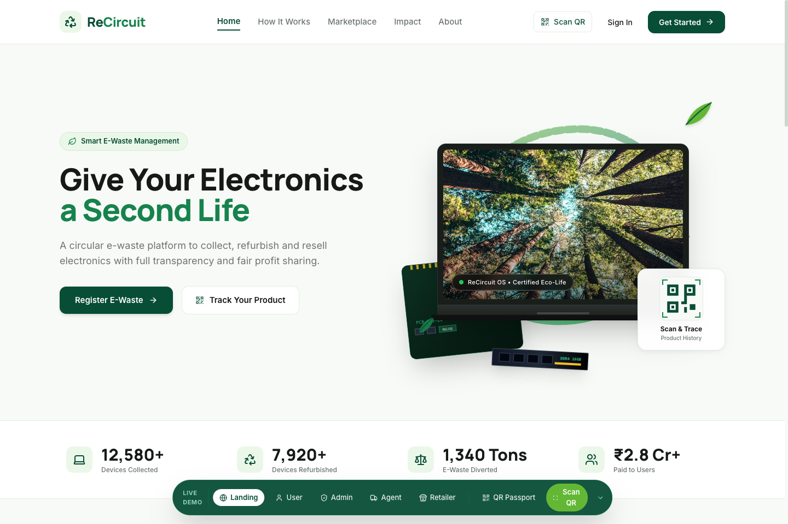
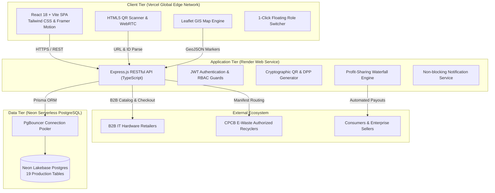
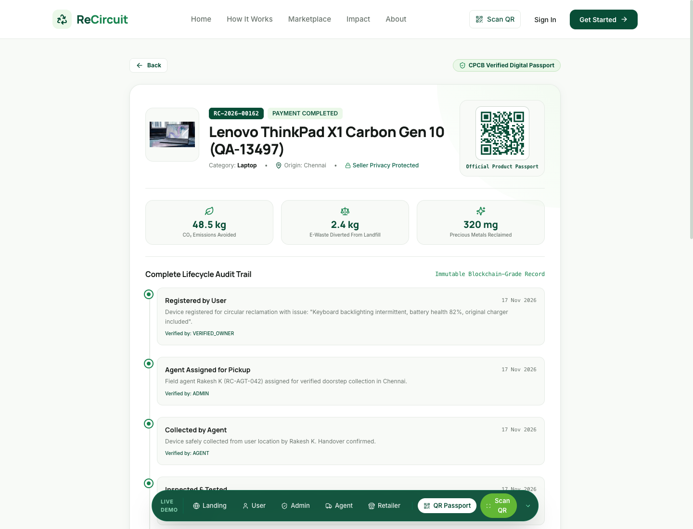
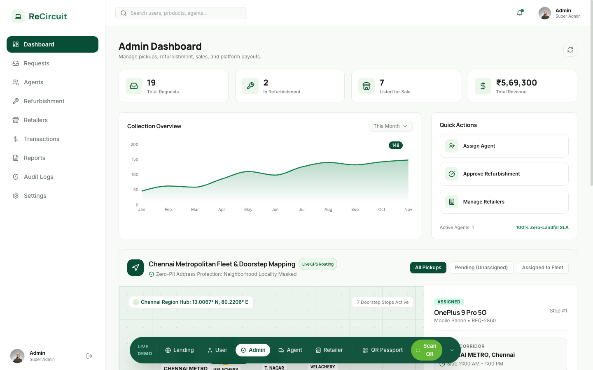
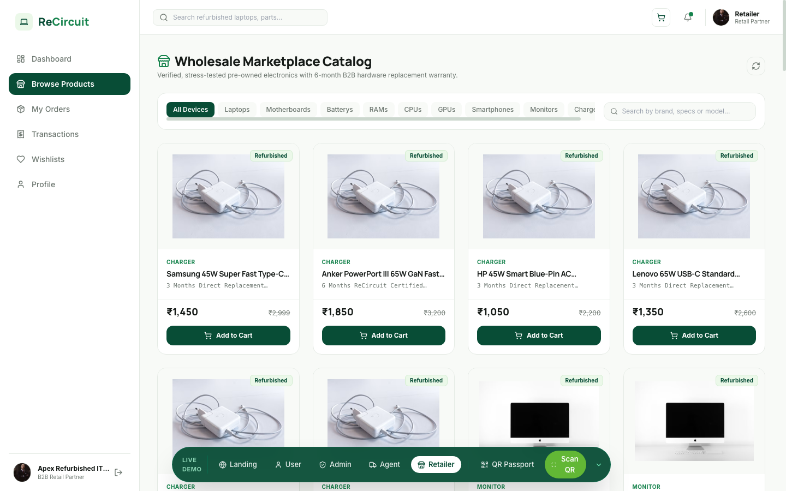
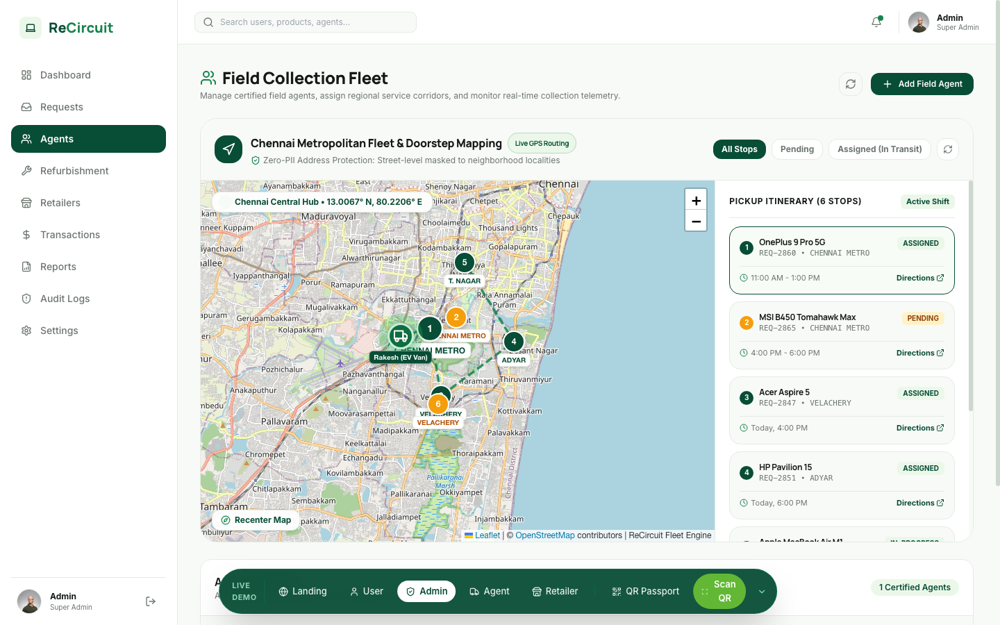
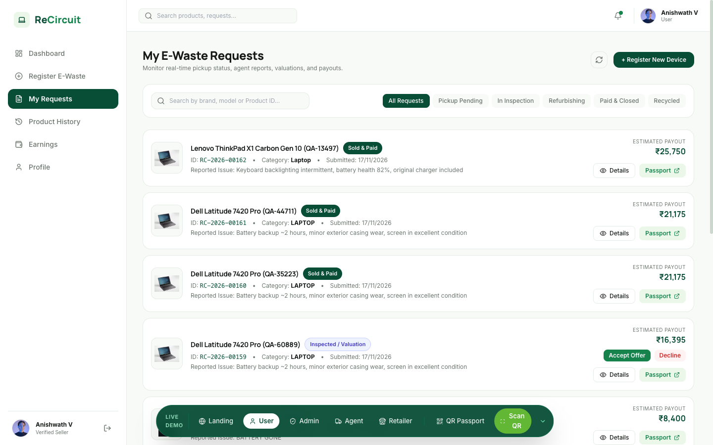
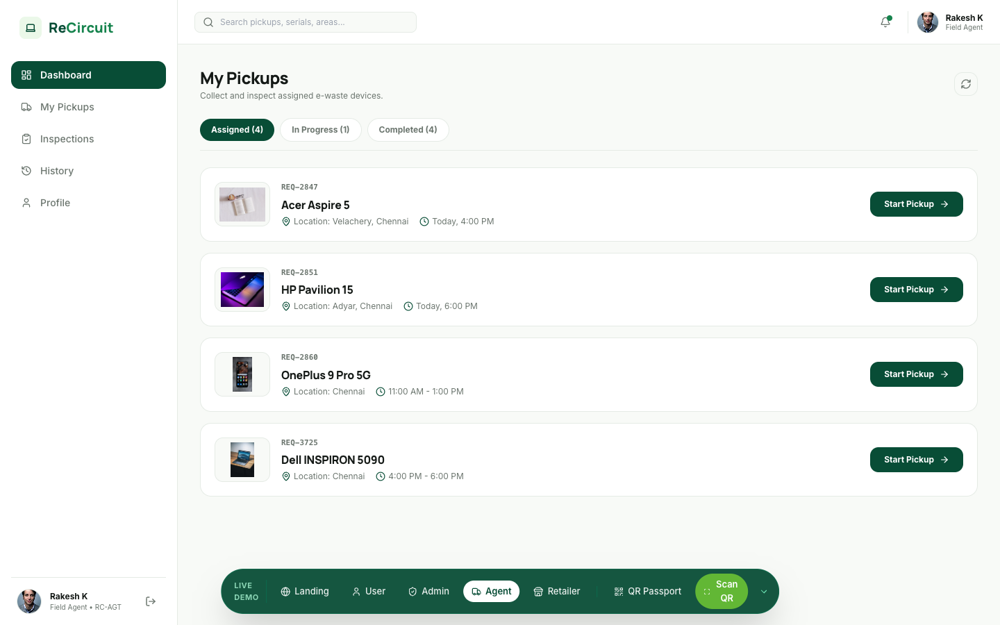

<div align="center">

# ♻️ ReCircuit

### **Next-Generation Circular E-Waste Management & Refurbishment Platform**

[](https://recircuit-frontend.vercel.app)
[](https://recircuit-api-uowv.onrender.com/api/health)
[](https://neon.tech)
[](https://www.typescriptlang.org/)
[](LICENSE)

<br />

<p align="center">
  <b>ReCircuit</b> is an enterprise-grade, full-stack circular economy SaaS platform designed to collect, inspect, refurbish, and resell end-of-life electronics. Powered by <b>Digital Product Passports (DPP)</b>, <b>cryptographic QR codes</b>, <b>real-time GIS fleet dispatch</b>, and an <b>algorithmic profit-sharing waterfall engine</b>.
</p>

<p align="center">
  <a href="https://recircuit-frontend.vercel.app"><b>Explore Live App</b></a> •
  <a href="https://recircuit-api-uowv.onrender.com/api/health"><b>API Health</b></a> •
  <a href="https://recircuit-frontend.vercel.app/passport/RC-2026-00142"><b>View Sample Digital Passport</b></a> •
  <a href="#-quick-demo-access"><b>Demo Accounts</b></a>
</p>

---



</div>

---

## 📑 Table of Contents

- [🌍 The Problem & The ReCircuit Mission](#-the-problem--the-recircuit-mission)
- [⚡ Live Cloud Deployments](#-live-cloud-deployments)
- [🏗️ Full-Stack System Architecture](#️-full-stack-system-architecture)
- [✨ Core Capabilities & Innovations](#-core-capabilities--innovations)
  - [1. 4 Specialized Role Dashboards](#1-4-specialized-role-dashboards)
  - [2. Digital Product Passports & Cryptographic QR Engine](#2-digital-product-passports--cryptographic-qr-engine)
  - [3. 55-SKU Photorealistic Hardware Catalogue](#3-55-sku-photorealistic-hardware-catalogue)
  - [4. Algorithmic Profit-Sharing Waterfall](#4-algorithmic-profit-sharing-waterfall)
  - [5. Interactive GIS Fleet Logistics & Route Dispatch](#5-interactive-gis-fleet-logistics--route-dispatch)
  - [6. Real-Time QR Web Camera Scanner](#6-real-time-qr-web-camera-scanner)
- [📸 Dashboard Showcase](#-dashboard-showcase)
- [🔄 12-Stage Circular Lifecycle Workflow](#-12-stage-circular-lifecycle-workflow)
- [🔑 Quick Demo Access](#-quick-demo-access)
- [🔌 RESTful API Reference](#-restful-api-reference)
- [🗄️ Database Architecture & Data Model](#️-database-architecture--data-model)
- [💻 Local Development Quickstart](#-local-development-quickstart)
- [☁️ Production Cloud Deployment](#️-production-cloud-deployment)
- [🌱 Environmental & ESG Impact Formulas](#-environmental--esg-impact-formulas)
- [🛡️ Security Posture](#️-security-posture)
- [📄 License & Acknowledgements](#-license--acknowledgements)

---

## 🌍 The Problem & The ReCircuit Mission

Over **62 million metric tons** of electronic waste are discarded globally each year, with less than 22% properly documented, collected, or recycled. Unreclaimed e-waste poisons soil and groundwater with toxic heavy metals (lead, mercury, cadmium) while discarding billions of dollars in recoverable rare-earth elements, gold, and copper.

Traditional electronics recycling suffers from three critical bottlenecks:
1. **Opaque Pricing & Middlemen**: Consumers and enterprises receive arbitrary, low valuations with zero transparency on refurbishing margins.
2. **Absence of Chain-of-Custody**: Devices disappear into unverified scrap streams without tracking or data sanitation certificates.
3. **Fragmented Secondary Markets**: Retailers lack reliable sources of certified, pre-tested components backed by warranties.

### The ReCircuit Solution
ReCircuit transforms the linear *"take-make-waste"* model into a transparent, self-sustaining **circular economy ecosystem**:
- **Automated Algorithmic Valuation**: Transparent waterfall breakdowns show exactly where every rupee goes.
- **CPCB-Compliant Digital Product Passports**: Every device receives an immutable lifecycle history with diagnostic logs and carbon diversion audit trails.
- **Certified B2B Hardware Procurement**: Tested refurbished components and devices with warranties sold directly to verified IT retailers.
- **Fair Profit-Sharing**: Original owners receive bonus payouts when their refurbished electronics are sold.

---

## ⚡ Live Cloud Deployments

| Component | Platform | URL | Health & Monitoring |
| :--- | :--- | :--- | :--- |
| **Frontend Web App** | **Vercel** | [https://recircuit-frontend.vercel.app](https://recircuit-frontend.vercel.app) | `HTTP 200` • Single Page Application • Global Edge CDN |
| **Backend REST API** | **Render** | [https://recircuit-api-uowv.onrender.com](https://recircuit-api-uowv.onrender.com) | `HTTP 200` • Node.js LTS • Express • Auto-deploy |
| **Serverless Database** | **Neon** | `shy-dew-15332185.ap-southeast-1.neon.tech` | `Online` • PostgreSQL 17 • PgBouncer Pooled Runtime |
| **Public Passport** | **Vercel / Render** | [Sample Passport: RC-2026-00142](https://recircuit-frontend.vercel.app/passport/RC-2026-00142) | Verified CPCB Certificate & Dynamic SVG QR Code |

---

## 🏗️ Full-Stack System Architecture



---

## ✨ Core Capabilities & Innovations

### 1. 4 Specialized Role Dashboards
- 👤 **User Dashboard (`/dashboard`)**:
  - Step-by-step submission of surplus electronics with instant condition assessment.
  - Interactive 12-stage lifecycle progress bar with real-time status updates.
  - Transparent valuation offer card displaying resale estimate, refurbishment cost, collection cost, and net user payout with 1-click **Accept / Reject**.
  - Eco-savings tracker (Total CO₂ offset, e-waste weight diverted, precious metals reclaimed).
- 🛡️ **Admin Dashboard (`/admin`)**:
  - Operations command center with volume KPIs, monthly collection area charts, and category breakdowns.
  - Fleet management and agent assignment modal with automated schedule dispatch.
  - Refurbishment quality approval and direct marketplace listing.
  - CPCB-authorized recycler routing for non-repairable e-waste with manifest recording.
  - Configurable profit-sharing waterfall rules per hardware category.
- 🛵 **Field Agent Dashboard (`/agent`)**:
  - Mobile-responsive pickup management interface categorized by `Assigned`, `In Progress`, and `Completed`.
  - 32-point doorstep hardware inspection diagnostic checklist (battery cycle health, cosmetic grade, motherboard testing, display integrity).
  - Photographic proof-of-collection upload with automatic image optimization.
- 🛒 **Retailer Dashboard (`/retailer`)**:
  - B2B procurement marketplace featuring certified pre-owned enterprise electronics.
  - Multi-facet filtering by category, hardware condition grade, brand, and price bracket.
  - Integrated shopping cart drawer with instant GST-compliant B2B invoice generation.

### 2. Digital Product Passports & Cryptographic QR Engine
Every registered electronic device is issued a permanent, tamper-resistant **Digital Product Passport (DPP)** conforming to European Union and Indian Central Pollution Control Board (CPCB) circularity standards:
- **Vector SVG QR Code**: Rendered in brand Forest Green (`#084D36`) on high-contrast white.
- **Public Proof of Provenance**: Accessible without login at `/passport/:customId`.
- **Full Chronological Timeline**: Immutable history recording registration, agent pickup, technical diagnostic results, technician signature, replacement parts, and final retailer transfer.
- **Privacy Sanitization**: Original seller personal identifiable information (PII) is cryptographically stripped and masked.

### 3. 55-SKU Photorealistic Hardware Catalogue
Unlike generic mockups, ReCircuit features a **100% SKU-level photographic catalogue** across 55 unique electronics products with authentic component representations:
- **GPUs**: Dedicated discrete graphics cards (Zotac RTX 3060 12GB, EVGA RTX 3070, MSI RX 6600, Gigabyte GTX 1660 Super, Asus Dual RTX 2060, Sapphire Pulse RX 580) — no generic cabinets.
- **Motherboards**: Authentic circuit boards with distinct chipsets (MSI MAG Z790 Tomahawk, Asus ROG Strix B550-F, Gigabyte B660M, ASRock B560 Pro4, Asus Prime H610M).
- **Batteries**: Distinct OEM battery geometry matching real hardware (ThinkPad cylindrical bar, MacBook Pro multi-cell flex, Dell 4GVGH, HP HT03XL).
- **CPUs, RAM, Laptops, Smartphones, Monitors & Chargers**: Authentic SKUs with zero duplicate stock photographs across different models.

### 4. Algorithmic Profit-Sharing Waterfall
ReCircuit eliminates opaque refurbishing margins through an automated financial distribution model:

$$\text{Net User Payout} = \text{Selling Price} - \text{Refurbishment Cost} - \text{Collection Fee} - \text{Platform Fee}$$

All deductions are displayed to both seller and buyer, and transactions are permanently stored in an immutable audit ledger.

### 5. Interactive GIS Fleet Logistics & Route Dispatch
Integrated with real **Leaflet GIS mapping**, dispatchers and agents can view live geographic clusters of pickups across major hubs (Chennai, Bengaluru, Hyderabad, Mumbai, Delhi):
- Status-coded interactive map pins (Pending, Assigned, In Progress, Collected).
- Click-to-inspect popup cards showing customer address, device model, and contact details.
- Fleet route visualization for optimized daily collection runs.

### 6. Real-Time QR Web Camera Scanner
High-speed camera scanner powered by `html5-qrcode` directly in the browser:
- Instant device recognition via webcam or mobile camera.
- Parses both full URLs (`https://recircuit-frontend.vercel.app/passport/RC-2026-00142`) and raw IDs (`RC-2026-00142`).
- 1-click navigation to the verified Digital Product Passport.

---

## 📸 Dashboard Showcase

<div align="center">

| **Public Digital Product Passport** | **Admin Operations Command Center** |
| :---: | :---: |
|  |  |
| *Verifiable CPCB passport with QR code & timeline* | *Operations overview, KPIs, and monthly collection curves* |

| **B2B Retailer Hardware Catalogue** | **Interactive GIS Fleet Map** |
| :---: | :---: |
|  |  |
| *55 distinct hardware SKUs with authentic photography* | *Real-time Leaflet GIS mapping & pickup route dispatch* |

| **User Request & Valuation Tracker** | **Field Agent Doorstep Diagnostics** |
| :---: | :---: |
|  |  |
| *12-stage lifecycle tracker with transparent valuation* | *Mobile-ready 32-point hardware inspection checklist* |

</div>

---

## 🔄 12-Stage Circular Lifecycle Workflow

```
[01. SUBMITTED] ────────► [02. APPROVED] ────────► [03. AGENT_ASSIGNED]
      │                                                   │
      ▼                                                   ▼
[06. VALUATION_PROPOSED] ◄─ [05. INSPECTED] ◄──── [04. COLLECTED]
      │
      ▼
[07. USER_ACCEPTED] ────► [08. REFURBISHED] ────► [09. QUALITY_APPROVED]
                                                          │
                                                          ▼
[12. PAYMENT_COMPLETED] ◄─ [11. SOLD_TO_RETAILER] ◄─ [10. LISTED_FOR_SALE]
```

1. **Submission**: User inputs device specifications, cosmetic condition, fault symptoms, and preferred doorstep pickup slot.
2. **Review & Approval**: Automated rule engine validates eligibility and assigns an initial sequential ID (`RC-2026-XXXXX`).
3. **Agent Assignment**: Admin assigns a certified local field technician based on geographic proximity.
4. **Collection**: Agent arrives at doorstep, confirms device identity, and uploads photographic verification.
5. **32-Point Diagnostic Inspection**: Agent conducts functional bench testing (power delivery, display, storage health, battery wear).
6. **Transparent Valuation**: Algorithmic engine calculates fair resale price, costs, and net user payout.
7. **User Approval**: Seller reviews transparent cost waterfall breakdown on their dashboard and accepts the offer.
8. **Refurbishment**: Certified technicians replace worn components, reapply thermal interface material, and complete stress tests.
9. **Quality Certification**: Admin issues official warranty certificate (e.g. `CERT-RC-81277`) and approves listing.
10. **B2B Listing**: Listed on the marketplace with detailed technical specs and warranty badges.
11. **Retailer Purchase**: B2B retailer purchases certified inventory with instant checkout and GST invoicing.
12. **Settlement**: Automated profit-sharing distributes funds to the seller, technician fee to the agent, and archives the transaction.

---

## 🔑 Quick Demo Access

The live platform includes a **floating 1-click Quick Role Bar** at the bottom of the screen allowing instant switching between all four dashboards without manual sign-in:

| Role | Name | Email | Password | Primary Dashboard Route |
| :--- | :--- | :--- | :--- | :--- |
| 👤 **User (Seller)** | Anishwath V | `user@recircuit.com` | `password123` | [`/dashboard`](https://recircuit-frontend.vercel.app/dashboard) |
| 🛡️ **Administrator** | Super Admin | `admin@recircuit.com` | `password123` | [`/admin`](https://recircuit-frontend.vercel.app/admin) |
| 🛵 **Field Agent** | Rakesh K | `agent@recircuit.com` | `password123` | [`/agent`](https://recircuit-frontend.vercel.app/agent) |
| 🛒 **B2B Retailer** | Apex IT Hub | `retailer@recircuit.com` | `password123` | [`/retailer`](https://recircuit-frontend.vercel.app/retailer) |

---

## 🔌 RESTful API Reference

### Base URL: `https://recircuit-api-uowv.onrender.com/api`

### Authentication (`/auth`)
| Method | Endpoint | Description | Auth Required |
| :--- | :--- | :--- | :--- |
| `POST` | `/auth/login` | Standard email/password authentication | Public |
| `POST` | `/auth/demo-login` | 1-click role switcher authentication | Public (Configurable) |
| `POST` | `/auth/register` | New user account registration | Public |
| `GET` | `/auth/me` | Fetch authenticated session profile | Bearer JWT |

### Products & Passports (`/products`, `/passport`)
| Method | Endpoint | Description | Auth Required |
| :--- | :--- | :--- | :--- |
| `POST` | `/products` | Submit new e-waste product for collection | User JWT |
| `GET` | `/products/my-products` | List authenticated user's submitted devices | User JWT |
| `GET` | `/products/:id` | Fetch detailed device specifications | Bearer JWT |
| `GET` | `/passport/:customId` | Public Digital Product Passport resolution | **Public** |

### Logistics & Field Operations (`/pickups`, `/inspections`)
| Method | Endpoint | Description | Auth Required |
| :--- | :--- | :--- | :--- |
| `GET` | `/pickups/agent` | List pickups assigned to authenticated agent | Agent JWT |
| `POST` | `/pickups/assign` | Assign pickup request to field agent | Admin JWT |
| `PATCH` | `/pickups/:id/start` | Transition pickup status to IN_PROGRESS | Agent JWT |
| `PATCH` | `/pickups/:id/complete` | Complete pickup with notes & photo evidence | Agent JWT |
| `POST` | `/inspections` | Submit 32-point diagnostic inspection | Agent JWT |
| `PATCH` | `/inspections/:id/approve` | Approve inspection for refurb vs recycling | Admin JWT |

### Valuation & Refurbishment (`/valuations`, `/refurbishment`)
| Method | Endpoint | Description | Auth Required |
| :--- | :--- | :--- | :--- |
| `POST` | `/valuations/:productId/respond` | User accepts or rejects proposed payout | User JWT |
| `POST` | `/refurbishment/:productId/log` | Record technician parts & test diagnostics | Admin JWT |
| `POST` | `/refurbishment/:productId/quality-approve` | Certify warranty and list on marketplace | Admin JWT |

### Marketplace & Retailer Procurement (`/marketplace`)
| Method | Endpoint | Description | Auth Required |
| :--- | :--- | :--- | :--- |
| `GET` | `/marketplace` | Browse 55 verified refurbished hardware SKUs | **Public** |
| `GET` | `/marketplace/:id` | Detailed listing view with specs & warranty | **Public** |
| `POST` | `/marketplace/order` | Place B2B wholesale order for inventory | Retailer JWT |
| `GET` | `/marketplace/orders/my-orders` | Fetch retailer purchase history & invoices | Retailer JWT |

---

## 🗄️ Database Architecture & Data Model

The application uses **PostgreSQL 17** managed via **Prisma ORM** across 19 relational tables:

```
┌──────────────┐       ┌──────────────┐       ┌────────────────────┐
│     User     │──────<│   Product    │──────<│   PickupRequest    │
└──────────────┘       └──────────────┘       └────────────────────┘
       │                      │                         │
       │                      ├───────< Inspection      │
       │                      ├───────< Valuation       ▼
       ▼                      ├───────< Refurbishment ┌──────────────┐
┌──────────────┐              ├───────< ProductHistory│    Agent     │
│ Notification │              ├───────< RecyclerRecord└──────────────┘
└──────────────┘              ▼                         │
                       ┌──────────────────────┐         ▼
                       │  MarketplaceListing  │   ┌──────────────┐
                       └──────────────────────┘   │DeviceLocation│
                                  │               └──────────────┘
                                  ▼
                       ┌──────────────────────┐
                       │     Order / Item     │
                       └──────────────────────┘
                                  │
                                  ▼
                       ┌──────────────────────┐
                       │     Transaction      │
                       └──────────────────────┘
```

- **User**: Authentication, roles (`USER`, `ADMIN`, `AGENT`, `RETAILER`), contact details, and soft deletion.
- **Product**: Hardware specs, sequential custom ID (`RC-2026-XXXXX`), status state machine, valuation, QR SVG, and media.
- **PickupRequest**: Doorstep logistics, pickup time window, address, assigned agent, and completion notes.
- **Inspection**: 32-point technical checklist, battery health %, diagnostic notes, and action recommendation.
- **Valuation**: Estimated resale, refurbishment fee, collection fee, platform share, user payout, and approval flag.
- **Refurbishment**: Certificate number, technician name, replaced components, warranty duration, and stress test logs.
- **MarketplaceListing**: Retailer catalog entry, condition grade, B2B wholesale price, warranty, and availability flag.
- **Order & Transaction**: B2B purchase records, payment status, GST invoices, and financial profit-sharing settlement ledger.
- **ProfitSharingRule**: Configurable category-level profit splits, minimum fees, and platform percentages.

---

## 💻 Local Development Quickstart

### Prerequisites
- **Node.js**: v20.x or higher
- **npm**: v10.x or higher
- **PostgreSQL**: Local instance or remote Neon connection string

### 1. Clone the Monorepo
```bash
git clone https://github.com/anishwathvs/ReCircuit-Circular-E-waste-managament.git
cd ReCircuit-Circular-E-waste-managament
```

### 2. Backend Setup
```bash
cd backend
npm install

# Configure environment variables
cp .env.example .env
# Edit .env with your DATABASE_URL, DIRECT_URL, and JWT_SECRET

# Push schema to database
npx prisma db push

# Seed 55 authentic hardware SKUs and demo accounts
npm run prisma:seed

# Start development server
npm run dev
# Backend runs at: http://localhost:5001
```

### 3. Frontend Setup
```bash
cd ../frontend
npm install

# Start Vite development server
npm run dev
# Frontend runs at: http://localhost:5173
```

---

## ☁️ Production Cloud Deployment

### 1. Database (Neon Serverless PostgreSQL)
1. Create a Neon project with branch `production`.
2. Retrieve the pooled connection string (`DATABASE_URL`) and direct connection string (`DIRECT_URL`).
3. Push schema: `npx prisma db push`.
4. Seed catalog: `npm run prisma:seed`.

### 2. Backend (Render Web Service)
1. Create a new Web Service connected to your GitHub repository.
2. Root Directory: `backend`
3. Build Command: `npm install --include=dev && npx prisma generate && npm run build`
4. Start Command: `npm run start`
5. Configure Environment Variables:
   - `NODE_ENV=production`
   - `PORT=10000`
   - `DATABASE_URL=<neon-pooled-url>`
   - `DIRECT_URL=<neon-direct-url>`
   - `JWT_SECRET=<64-char-hex>`
   - `JWT_REFRESH_SECRET=<64-char-hex>`
   - `CLIENT_URL=https://recircuit-frontend.vercel.app`
   - `CORS_ORIGIN=https://recircuit-frontend.vercel.app,https://recircuit-frontend-*.vercel.app`
   - `ALLOW_DEMO_LOGIN=true`

### 3. Frontend (Vercel)
1. Import repository on Vercel.
2. Root Directory: `frontend`
3. Framework Preset: `Vite`
4. Build Command: `npm run build`
5. Output Directory: `dist`
6. Add Environment Variable:
   - `VITE_API_BASE_URL=https://recircuit-api-uowv.onrender.com`

---

## 🌱 Environmental & ESG Impact Formulas

ReCircuit quantifies environmental savings for every refurbished or recycled device using life cycle assessment (LCA) coefficients aligned with CPCB and IEEE 1680.1 standards:

### 1. Carbon Offset ($\text{CO}_2$ Avoided)
$$\text{CO}_2\text{ Offset (kg)} = \text{Embodied Carbon}_{\text{Mfg}} \times \text{Circularity Factor} \times \left(1 - \frac{\text{Refurb Energy}}{\text{New Production Energy}}\right)$$
*Example: Refurbishing a Dell Latitude 5420 saves approximately **18.4 kg to 48.5 kg CO₂e** compared to manufacturing a new unit.*

### 2. E-Waste Diverted from Landfills
$$\text{E-Waste Diverted (kg)} = \text{Product Weight (kg)} + \text{Packaging Waste Avoided (kg)}$$

### 3. Precious Metals Recovered
$$\text{Metals Yield (mg)} = \text{PCB Mass (g)} \times \sum_{i \in \{\text{Au, Ag, Pd, Cu}\}} \text{Concentration}_i$$
*ReCircuit certificates report milligram-level yields for gold, silver, and copper diverted from toxic slag.*

---

## 🛡️ Security Posture

- **Cryptographic Password Hashing**: Passwords stored using `bcryptjs` with salt rounds = 10.
- **Dual-Token Authentication**: Ephemeral access tokens (15m expiry) paired with secure refresh tokens (7d expiry).
- **Role-Based Access Control (RBAC)**: Route-level middleware strictly validates caller roles (`USER`, `ADMIN`, `AGENT`, `RETAILER`).
- **Production CORS Policy**: Whitelist restricted to verified Vercel origins; untrusted origins rejected without leaking server traces.
- **SQL Injection Immune**: All database queries parameter-bound through Prisma ORM prepared statements.
- **Data Privacy**: Public QR passports cryptographically mask all user contact information and physical addresses.

---

## 📄 License & Acknowledgements

This project is licensed under the **MIT License** — see the [LICENSE](LICENSE) file for details.

### Developed with Pride for Sustainable Computing
Built with circular economy principles to empower transparent e-waste management, verified component reuse, and fair profit-sharing across India and the globe. 🌍♻️

<div align="center">
  <sub>Designed & Developed by <b>Anishwath V</b> • ReCircuit Circular Economy Platform</sub>
</div>
