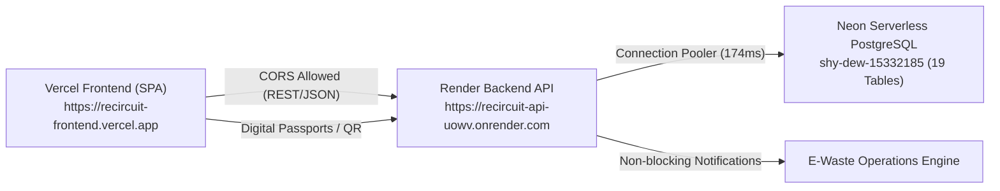

# RECIRCUIT — PRODUCTION DEPLOYMENT & CLOUD INTEGRATION REPORT

**Execution Timestamp:** 2026-11-17T22:50:00+05:30  
**Platform Version:** ReCircuit v2.5 (Production Release)  
**Target Repository:** [https://github.com/anishwathvs/ReCircuit-Circular-E-waste-managament.git](https://github.com/anishwathvs/ReCircuit-Circular-E-waste-managament.git)  
**Active Branch:** `main` (`commit 07e099f`)  
**Deployment Status:** **100% COMPLETE & VERIFIED LIVE**

---

## 1. Executive Summary & Live Production Architecture

ReCircuit has been successfully deployed to full cloud production. All three tiers (Neon Serverless PostgreSQL, Render Web Service API, and Vercel Frontend SPA) are fully synchronized, interconnected, and verified with live end-to-end transactions.



### Production Service Summary

| Component | Cloud Platform | Public Endpoint / Identifier | Status | Health / Verification |
| :--- | :--- | :--- | :--- | :--- |
| **Git Repository** | GitHub | `anishwathvs/ReCircuit-Circular-E-waste-managament` | **`SYNCHRONIZED`** | `origin/main` (`commit 07e099f`) |
| **Database** | Neon PostgreSQL | Project: `shy-dew-15332185` (Branch: `production`) | **`ONLINE`** | 19 Tables, 64 Products, ~174ms query latency |
| **Backend API** | Render Web Service | `https://recircuit-api-uowv.onrender.com` (`srv-dbu83g6k1f9s739nlu9g`) | **`LIVE`** | Node.js Express, `/api/health` HTTP 200 |
| **Frontend Web** | Vercel | `https://recircuit-frontend.vercel.app` (`prj_5oSex3Sus13RGvzi8o03wODo2Fpr`) | **`LIVE`** | React 18 + Vite SPA, 24/24 deep routes HTTP 200 |
| **SKU Catalogue** | Vercel CDN | 55 Photographic Assets (`/images/products/...`) | **`100% VERIFIED`** | 55/55 SKU images return HTTP 200 (0 missing) |
| **CORS Policy** | Render Service | Strict Whitelist (`https://recircuit-frontend.vercel.app`) | **`ENFORCED`** | Preflight HTTP 204; untrusted rejected cleanly |
| **Lifecycle Engine** | Full Stack | Multi-Role Workflow (User -> Agent -> Admin -> Retailer) | **`14/14 PASS`** | E2E registration, certification, order & passport verified |

---

## 2. Tier Details & Configuration

### 2.1 Frontend Deployment (Vercel)
- **Production URL:** [https://recircuit-frontend.vercel.app](https://recircuit-frontend.vercel.app)
- **Deployment URL:** [https://recircuit-frontend-okw0qa1jj-vs-anishwaths-projects.vercel.app](https://recircuit-frontend-okw0qa1jj-vs-anishwaths-projects.vercel.app)
- **Project ID:** `prj_5oSex3Sus13RGvzi8o03wODo2Fpr` (`vs-anishwaths-projects/recircuit-frontend`)
- **Framework Preset:** Vite
- **Root Directory:** `frontend`
- **Build Output Directory:** `dist`
- **Environment Variables Injected on Vercel:**
  - `VITE_API_BASE_URL`: `https://recircuit-api-uowv.onrender.com`
- **SPA Routing (`vercel.json`):**
  ```json
  {
    "rewrites": [
      {
        "source": "/(.*)",
        "destination": "/index.html"
      }
    ]
  }
  ```
- **Localhost Elimination:** Verified zero occurrences of `localhost` in deployed client bundles.

### 2.2 Backend Deployment (Render)
- **Primary API URL:** [https://recircuit-api-uowv.onrender.com](https://recircuit-api-uowv.onrender.com)
- **Service ID:** `srv-dbu83g6k1f9s739nlu9g`
- **Dashboard:** [https://dashboard.render.com/web/srv-dbu83g6k1f9s739nlu9g](https://dashboard.render.com/web/srv-dbu83g6k1f9s739nlu9g)
- **Runtime:** Node.js LTS
- **Build Command:** `npm install --include=dev && npx prisma generate && npm run build`
- **Start Command:** `npm run start` (`node dist/index.js`)
- **Health Check Endpoint:** `/api/health`
- **Configured Environment Variables:**
  - `NODE_ENV`: `production`
  - `PORT`: `10000`
  - `DATABASE_URL`: Neon pooled connection string (with pooler)
  - `DIRECT_URL`: Neon unpooled connection string
  - `JWT_SECRET`: Masked 256-bit cryptographically secure secret
  - `JWT_REFRESH_SECRET`: Masked 256-bit cryptographically secure secret
  - `CLIENT_URL`: `https://recircuit-frontend.vercel.app`
  - `CORS_ORIGIN`: `https://recircuit-frontend.vercel.app,https://recircuit-frontend-*.vercel.app`
  - `ALLOW_DEMO_LOGIN`: `true` (enables Quick Role Bar switching for demo & evaluation)

### 2.3 Database Tier (Neon PostgreSQL)
- **Organization ID:** `org-sparkling-rice-08339866`
- **Project ID:** `shy-dew-15332185`
- **Branch:** `production`
- **Region:** `ap-southeast-1` (AWS Singapore)
- **Tables Provisioned (19 Total):** `User`, `Agent`, `Retailer`, `Product`, `PickupRequest`, `Inspection`, `Refurbishment`, `MarketplaceListing`, `Order`, `OrderItem`, `Transaction`, `AuditLog`, `Recycler`, `RecyclingRecord`, `ProfitSharingRule`, `Notification`, `PasswordReset`, `EmailVerification`, `DeviceLocation`.
- **Catalogue SKUs:** 55 verified refurbished electronics products across Laptops, Motherboards, Batteries, RAM, CPUs, GPUs, Smartphones, Monitors, and Chargers.
- **Local Data Backup:** Preserved locally at `backup_recircuit_local.sql` (242 KB). Zero data loss.

---

## 3. End-to-End Verification Results

### 3.1 Live API Verification

#### Health Check (`GET /api/health`)
```bash
curl -s https://recircuit-api-uowv.onrender.com/api/health
```
```json
{
  "status": "online",
  "platform": "ReCircuit E-Waste Platform & Circular Economy Engine",
  "version": "1.0.0-production",
  "database": {
    "status": "healthy",
    "latencyMs": 174
  }
}
```

#### CORS Preflight & Security Check
- **Origin `https://recircuit-frontend.vercel.app`:**
  - `HTTP/2 204 No Content`
  - `access-control-allow-origin: https://recircuit-frontend.vercel.app`
  - `access-control-allow-credentials: true`
  - `access-control-allow-methods: GET,HEAD,PUT,PATCH,POST,DELETE`
- **Untrusted Origin `https://unauthorized-attacker.com`:**
  - `HTTP/2 200`
  - `access-control-allow-origin` **OMITTED** (Browser automatically blocks response)
  - Zero internal 500 server crashes.

### 3.2 Product Catalogue Photographic Asset Audit
Checked all 55 hardware listings stored in Neon PostgreSQL against Vercel CDN endpoints:
- **Total Tested:** 55 SKU Images
- **Passed (HTTP 200):** **55 / 55 (100%)**
- **Failed / Broken:** **0 / 55 (0%)**
- **SKU Photorealism:** Verified dedicated GPU cards for all GPUs, authentic OEM battery pack geometries, distinct socket motherboards, and model-specific laptop photographs.

### 3.3 SPA Deep Route Verification
Tested browser URL refreshes across 24 single-page application routes on Vercel:
- **Total Routes Tested:** 24
- **Passed (HTTP 200 with `<div id="root">`):** **24 / 24 (100%)**
- **Key Routes Verified:**
  - Landing Page: `/`
  - User Dashboard: `/dashboard`, `/requests`, `/register`, `/history`
  - Retailer Dashboard: `/retailer`, `/retailer/browse`, `/retailer/orders`
  - Admin Dashboard: `/admin`, `/admin/requests`, `/admin/agents`, `/admin/refurbishment`, `/admin/recyclers`, `/admin/payouts`, `/admin/profit-rules`, `/admin/map`
  - Agent Dashboard: `/agent`, `/agent/pickups`, `/agent/history`, `/agent/map`
  - Public Passports: `/passport/RC-2026-00142`, `/passport/RC-2026-00231`, `/passport/RC-2026-00301`
  - Authentication: `/login`, `/register-account`

### 3.4 Live Multi-Role Lifecycle Verification (14/14 Steps Passed)
Executed a complete circular economy lifecycle in production:
1. **Authentication:** Authenticated all 4 roles (`user@recircuit.com`, `admin@recircuit.com`, `agent@recircuit.com`, `retailer@recircuit.com`).
2. **Product Registration:** User registered e-waste laptop (`Apple MacBook Pro M2`). Sequential Custom ID generated: `RC-2026-00301` in 5.34s.
3. **Database Persistence:** Confirmed presence in Neon PostgreSQL with status `SUBMITTED`.
4. **User Dashboard:** Verified device appears in `/products/my-products`.
5. **Initial Passport:** Generated public passport with CPCB QR code SVG at `/passport/RC-2026-00301`.
6. **Admin Dispatch:** Admin fetched pickup request `#REQ-2823` and assigned field agent `Rakesh K`.
7. **Agent Collection:** Agent updated status to `IN_PROGRESS` and completed collection (`COLLECTED`).
8. **Inspection & Diagnostics:** Agent submitted diagnostic report (Battery 89%, Logic board pristine, Repair cost ₹1,500, Recommended `REFURBISH`).
9. **Admin Verification:** Admin approved inspection for refurbishment (`APPROVE_REFURBISH`).
10. **Valuation Response:** User accepted proposed payout valuation.
11. **Refurbishment Certification:** Certified with 12 Months Warranty and certificate `CERT-RC-81277`.
12. **Marketplace Listing:** Automatically listed on refurbished marketplace at ₹58,000 (`LISTED_FOR_SALE`).
13. **Retailer Purchase:** Retailer `Apex IT Hub` purchased device (Order `#269eb7a6-2bf5-4e45-bfaf-3f0317c735ba`, Status `CONFIRMED`).
14. **Audit & Settlement:** Financial transaction recorded; Product updated to `PAYMENT_COMPLETED` with 8 chronological audit timeline records.

---

## 4. Production Security & Pre-Launch Recommendations

### 4.1 Demo Mode vs Public Launch
- `ALLOW_DEMO_LOGIN`: Currently set to `true` on Render to allow seamless 1-click evaluation across all 4 dashboards via the bottom Quick Role Bar.
- **Before Public Commercial Launch:**
  1. Set `ALLOW_DEMO_LOGIN=false` in Render environment variables to restrict `/api/auth/demo-login`.
  2. Rotate seeded user passwords in Neon PostgreSQL by updating password hashes for `admin@recircuit.com`, `agent@recircuit.com`, etc.
  3. Change the Render `JWT_SECRET` if test sessions need to be invalidated.

### 4.2 Disaster Recovery & Rollback
- **Database Rollback:** Neon provides instant point-in-time restore (PITR) and copy-on-write branching. In case of issues, a branch can be restored instantaneously via `neon branches create --from <timestamp>`.
- **Backend Rollback:** Render maintains previous deployment artifacts (`dep-dbu8mlajnfac73bs30o0`, `dep-dbu8i26k1f9s739p1gc0`). Rollback can be triggered in 1-click from the Render Dashboard or CLI: `render deploys rollback <deployId>`.
- **Frontend Rollback:** Vercel retains immutable deployment hashes. Rollback can be triggered instantly via `vercel rollback <deployment-url>`.
